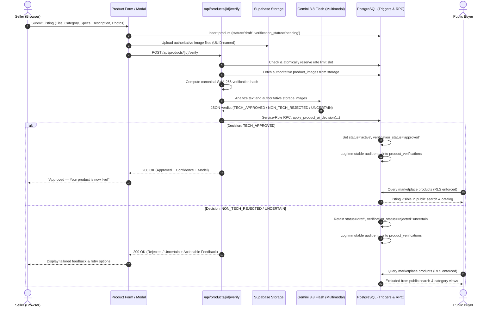

# CircuitCart — AI Automatic Product Verification System
## Comprehensive Technical Documentation, Security Architecture & Deployment Runbook
*Version: 2.1 — Production Ready (October 2026)*

---

## 1. Executive Summary & Objective

**CircuitCart** is a curated technology marketplace dedicated to computing hardware, mobile electronics, PC components, and consumer gadgets. To protect catalog purity and brand integrity without introducing administrative bottlenecks, the **AI Automatic Product Verification System** provides:

1. **Automated Approval for Real Tech**: Authentic electronics (laptops, GPUs, phones, peripherals, storage, components) receive automated AI approval and live market activation within seconds.
2. **Immediate Rejection for Non-Tech Items**: Unrelated listings (e.g., fresh flowers, makeup, cosmetics, fashion apparel, jewelry, food) are immediately gated from public visibility.
3. **Defense Against Deception**: Prompt-injection attacks, disguised listings (e.g., lipstick titled as an RTX 4090), and content mismatches between image and text are detected and flagged.
4. **Continuous Listing Integrity**: Material edits to title, category, specs, description, or photos automatically revoke approval and reset the listing to draft status pending AI re-verification. Price and stock adjustments do not trigger demotion.
5. **Zero-Downtime Transition**: Legacy seller forms inserting `status = 'active'` are safely coerced to `status = 'draft'` and `verification_status = 'pending'`, preventing transition-window crashes.
6. **Safe Production Fallback**: If the AI API is unconfigured, unreachable, or returns an error (such as a temporary Google HTTP 503 spike), listings remain safely unpublished as `draft` (`verification_status = 'uncertain'`) and are **never** auto-approved.

---

## 2. End-to-End System Architecture

### Information Flow Diagram



---

## 3. Database Security & Integrity Layer

All verification rules are enforced at the PostgreSQL database level using row-level security (RLS), security-definer triggers, and restricted RPC functions.

### A. Extended `products` Schema
The `public.products` table is augmented with verification metadata:
- `verification_status` (`text`, check: `'pending'`, `'approved'`, `'rejected'`, `'uncertain'`): Current review state. Default: `'pending'`.
- `grace_expires_at` (`timestamptz`, nullable): Dedicated timestamp marking the hard expiry of temporary migration grace.
- `verification_reason` (`text`, nullable): Human-readable justification provided by the AI engine or quarantine mechanism.
- `verification_content_hash` (`text`, nullable): Canonical SHA-256 hash of the exact listing content and images evaluated.
- `verified_at` (`timestamptz`, nullable): Timestamp of the decision.
- `verified_by_model` (`text`, nullable): Model name (`'gemini-3.8-flash'`, `'legacy_rollout_quarantine'`, `'legacy_migration_grace'`).

### B. Product Verification Guard Trigger (`trg_product_verification_guard`)
Enforces database invariants regardless of how a request is submitted:
1. **Direct Approval Block**: Unprivileged client roles (`authenticated`, `anon`) cannot set `verification_status = 'approved'`.
2. **Direct Activation Block**: Unprivileged clients cannot set `status = 'active'` unless `verification_status = 'approved'`.
3. **Zero-Downtime Insert Coercion**: If a legacy client or in-flight form inserts `status = 'active'` without approved status, the trigger safely coerces `status := 'draft'` and `verification_status := 'pending'` instead of raising a fatal `42501` exception.
4. **Material Edit Invalidation**: If a seller updates `title`, `category`, `specs`, or `description` on an approved listing, the trigger automatically resets:
   - `verification_status := 'pending'`
   - `status := 'draft'`
   - `verification_content_hash := null`
   - `verified_at := null`
   - `verification_reason := 'Listing details modified. Pending AI re-verification.'`
5. **Exemption for Price & Stock**: Sellers can adjust pricing and inventory quantities without losing approved status.

### C. Image Modification Invalidation Trigger (`trg_product_images_verification_invalidation`)
When rows in `public.product_images` are inserted, modified, or deleted by a seller, this trigger demotes the associated product to `draft` + `pending`.

### D. Storage Object Hardening & Path-Reuse Protection
To eliminate post-approval image replacement vectors:
1. **UPDATE Revoked**: Sellers cannot overwrite existing storage objects in place.
2. **DELETE Restricted to Orphaned Files**: A seller cannot delete a storage object while a `public.product_images` row still references it (`not public.is_product_image_path_referenced(name)`).
3. **INSERT Restricted to New Paths**: Sellers cannot re-upload to an existing path that is already referenced by a product image.
4. **Immutable Path Trigger (`trg_prevent_product_image_path_rewrite`)**: Sellers cannot mutate `storage_path` in `public.product_images`.
5. **Legitimate Image Swap Workflow**: The seller must delete the `product_images` row first (which automatically demotes the listing to `draft` + `pending`), and only then can the orphaned storage object be deleted.

### E. Authoritative Decision RPC (`apply_product_ai_decision`)
- Defined as `SECURITY DEFINER` with permissions revoked from `public`, `anon`, and `authenticated`.
- Granted exclusively to `service_role`.
- Row-level lock (`for update`) prevents concurrency races.
- Verifies `p_expected_hash` against the live listing hash (`calculate_product_verification_hash(product_id)`) to ensure the seller did not alter images or text during the AI roundtrip.
- Records an immutable audit log entry in `public.product_verifications`.

---

## 4. Legacy Product Quarantine & Dedicated Grace Expiry

During migration rollout, pre-existing active listings are partitioned to prevent disruptive downtime while ensuring non-tech listings are permanently removed.

### A. Immediate Non-Tech Quarantine (Step 2a)
Listings whose `title` or `category` matches known non-tech patterns are immediately demoted at migration time:
- Set to `status = 'draft'`, `verification_status = 'rejected'`, `verified_by_model = 'legacy_rollout_quarantine'`.
- Zero seconds of public marketplace exposure post-migration.

### B. False-Positive Protection
- **Descriptions are excluded** from quarantine keyword scans. Legitimate technology listings containing phrases such as `"cosmetic condition"` or `"rose gold"` will **not** be quarantined.
- **Whole-word regex matching (`\m...\M`)** prevents substring collisions.
- **Technology Guard (`legacy_listing_has_tech_indicator`)**: Listings containing explicit technology terms (e.g., `iphone`, `rtx`, `laptop`, `128gb`, `ram`, `gpu`, `peripherals`) are protected from keyword quarantine and receive temporary grace.

#### Verified Live Database Cases:
| Listing Title | Category / Notes | Migration Result | Reason |
| :--- | :--- | :--- | :--- |
| **Flower bouquet** | Gifts | `draft` / `rejected` | Quarantined (`legacy_rollout_quarantine`) |
| **Flower Knows Make ups** | Beauty | `draft` / `rejected` | Quarantined (`legacy_rollout_quarantine`) |
| **IPhone 16 128gb** | Smartphones ("cosmetic condition" in desc) | `active` / `approved` | Preserved in grace (`legacy_migration_grace`) |
| **IPhone 16 526gb** | Smartphones ("cosmetic condition" in desc) | `active` / `approved` | Preserved in grace (`legacy_migration_grace`) |

### C. Enforceable 7-Day Expiry Ceiling via `grace_expires_at`
To guarantee that listings tagged with `legacy_migration_grace` cannot remain publicly approved indefinitely if batch re-verification is delayed:
1. **Dedicated Rollout Timestamp (`grace_expires_at`)**:
   - The 7-day countdown begins **at migration execution time (`clock_timestamp() + interval '7 days'`)**, NOT from historical `published_at` or `created_at`.
   - This prevents active products published >7 days ago (14 of 20 live products) from prematurely disappearing upon rollout.
2. **Public RLS Policy Expiry Check**: The `products` RLS select policy requires `clock_timestamp() <= grace_expires_at` for grace items. At 7 days post-migration, unverified grace items automatically become hidden from public view even if no cleanup script has executed.
3. **Database Cleanup Function**: `public.expire_stale_legacy_grace_listings()` demotes expired unverified grace items (`clock_timestamp() > grace_expires_at`) to `status = 'draft'`, `verification_status = 'uncertain'`.
4. **Operator View**: `public.legacy_grace_pending_verification` provides live counts, `grace_expires_at` timestamps, and an `is_expired` boolean flag.

---

## 5. Migration History Reconciliation (21 Remote vs. 26 Local)

### A. Forensic Analysis of Schema Discrepancy
- **Live Supabase**: Contains **21 applied migrations** recorded in `supabase_migrations.schema_migrations`.
- **GitHub Master**: Contains **26 migration files**.
- **Root Cause**: Earlier features (`seller_payout_request`, `private_offers_meetup_deposits`, and `research_delivery_time_export`) were applied to the remote database under consolidated or differing version timestamps. Production already contains:
  - Table: `public.chat_offers`
  - Function: `public.send_chat_offer`
  - Table: `public.seller_payout_requests`
  - Function: `public.request_seller_payout`

### B. Risk of Blind CLI `db push`
Running `npx supabase db push` blindly would cause the CLI to attempt to replay local migration files (`20261012133806_private_offers_meetup_deposits.sql`, `20261012153500_fix_chat_negotiation_rpc.sql`, etc.) which define existing schema objects. This causes immediate failure:
```text
ERROR: relation "chat_offers" already exists
ERROR: function "send_chat_offer" already exists
```

### C. Safe Isolated Deployment Strategy
The only unapplied schema changes belong to `20261013130000_ai_product_verification.sql`. Because this file is completely idempotent and wrapped in a transaction block, it can be applied directly without replaying historical files:
1. Apply `supabase/migrations/20261013130000_ai_product_verification.sql` via the Supabase Dashboard SQL Editor (or direct `psql`).
2. Record the migration in the remote tracker:
   ```sql
   insert into supabase_migrations.schema_migrations (version, statements, name)
   values ('20261013130000', null, 'ai_product_verification')
   on conflict do nothing;
   ```

---

## 6. Batch Re-Verification & Drain Automation

### A. Batch Re-Verification Endpoint (`POST /api/products/reverify-all`)
- **Authentication**: Accepts secret header `x-admin-secret` (or legacy `x-admin-key`) equal to `ADMIN_REVERIFY_SECRET` (compared in constant time via `crypto.timingSafeEqual`), or an authenticated user with `role = 'admin'` in `public.profiles`.
- **Safe Outage Handling**: If the AI API is temporarily unavailable, items are **skipped** rather than falsely marked uncertain or draft, keeping legitimate grace listings online until retried.
- **Reporting**: Reports `remainingLegacyGrace` in its response JSON so progress can be monitored.

### B. Automated Re-Verification Runner Script (`scripts/reverify-legacy-grace.mjs`)
An automated node script loops through `/api/products/reverify-all` in batches until all grace listings have received real AI verification:
```powershell
$env:CIRCUITCART_BASE_URL = "https://your-domain.com"
$env:ADMIN_REVERIFY_SECRET = "<your-admin-reverify-secret>"
node scripts/reverify-legacy-grace.mjs
```

---

## 7. Verification Results & Test Coverage

### A. Automated Test Suite (Exit Code: 0)
**52 / 52 automated tests passed:**
- **38 AI Verification Core Tests**: Covers legitimate electronics approval, non-tech rejection, disguised listings, prompt-injection defense, rate limiting, and Gemini error handling.
- **3 Legacy Quarantine & Expiry Tests**: Validates quarantine of flowers/makeup, grace protection of iPhones with "cosmetic condition", RLS expiry after 7 days, and the cleanup function.
- **6 Private Offer & Meetup Deposit Tests**: Validates that 50% deposit checkout, chat offers, commission math, and orders logic remain completely intact.
- **5 OCR Receipt Verification Tests**: Validates synthetic receipt parsing and memory lifecycle.

### B. Code Quality & Build Checks
- **ESLint**: Passed with 0 errors (Exit code: 0).
- **Next.js Production Build**: Compiled all 47 routes successfully with Turbopack and static page generation (Exit code: 0).

### C. Live Gemini Classification Check (4/4 Passed - Real Multimodal Inference)
Executed against Google Generative Language API using live key:
- **Test 1: Genuine Tech Listing (Apple MacBook Air M2 + real photo)**
  - Verdict: `TECH_APPROVED` (Confidence: 99%)
  - Reason: *"The submitted listing accurately describes and depicts a genuine consumer electronic device (Apple MacBook Air laptop), which fully complies with CircuitCart's technology-exclusive marketplace guidelines."*
- **Test 2: Obvious Non-Tech Listing (Fresh Flower Bouquet)**
  - Verdict: `NON_TECH_REJECTED` (Confidence: 100%)
  - Reason: *"CircuitCart is strictly an electronics and technology marketplace. Fresh flower bouquets are non-technology items and are prohibited."*
- **Test 3: Disguised Non-Tech Listing (Makeup Disguised as Hardware)**
  - Verdict: `NON_TECH_REJECTED` (Confidence: 100%)
  - Reason: *"The listing attempts to sell non-technology cosmetic items (makeup and beauty products) while improperly utilizing a computer hardware title, which violates marketplace policy."*
- **Test 4: Ambiguous Listing (Mystery electronic box with cut wire & no photos)**
  - Verdict: `UNCERTAIN` (Confidence: 50%)
  - Reason: *"The listing provides no photos and vague text describing a mystery item with a cut wire and no model number, making it impossible to reliably verify its technology status."*

### D. Staging Full Migration & Safe Rollback Validation (100% Passed)
- Executed full migration against staging PostgreSQL baseline matching 21 production migrations.
- Quarantined `Flower bouquet` and `Flower Knows Make ups` to `draft` + `rejected`.
- Preserved `IPhone 16 128gb` and `IPhone 16 526gb` (with `"cosmetic condition"` in descriptions) as `active` in grace with dedicated `grace_expires_at`.
- Verified pre-existing `send_chat_offer` RPC remained fully operational.
- Verified safe rollback dropped triggers, restored public view, preserved non-tech quarantines strictly in `draft` status, lifted temporary grace expiry on legitimate tech, and left `supabase_migrations.schema_migrations` intact.

---

## 8. Production Deployment Runbook

### Phase 1: Environment Variables Setup
Configure the following in your hosting provider (Vercel / Node server) and Supabase settings:

| Variable | Description | Where to Set |
| :--- | :--- | :--- |
| `GEMINI_API_KEY` | API key from [Google AI Studio](https://aistudio.google.com) | Hosting Provider Settings |
| `ADMIN_REVERIFY_SECRET` | 32+ character random string for batch admin verification | Hosting Provider Settings |
| `SUPABASE_SERVICE_ROLE_KEY` | Supabase Service Role secret key | Hosting Provider Settings |

### Phase 2: Live Gemini Classification Test (Local Pre-Check)
Verify that real multimodal classification succeeds against Google's API:
```powershell
$env:GEMINI_API_KEY = "your-actual-api-key"
node scripts/test-live-gemini.mjs
```
*Confirm that Gaming Laptop returns `TECH_APPROVED`, Flower Bouquet returns `NON_TECH_REJECTED`, and Disguised Makeup returns `NON_TECH_REJECTED`.*

### Phase 3: Apply Database Migration
Execute `supabase/migrations/20261013130000_ai_product_verification.sql` in the **Supabase Dashboard SQL Editor**:
1. Open Supabase Dashboard -> Project `enqszefcxqsocvzvfjym` -> **SQL Editor**.
2. Paste the complete contents of `supabase/migrations/20261013130000_ai_product_verification.sql`.
3. Click **Run**.
4. Confirm successful execution and insert the migration tracker record:
   ```sql
   insert into supabase_migrations.schema_migrations (version, statements, name)
   values ('20261013130000', null, 'ai_product_verification')
   on conflict do nothing;
   ```

### Phase 4: Deploy Next.js Codebase
1. Push git changes to GitHub `master`.
2. Trigger production deployment on your hosting platform.
3. Verify that `/api/products/[id]/verify` responds and seller product forms show the new verification badge.

### Phase 5: Execute Post-Deployment Batch Re-Verification
Drain the legacy grace queue by running the automation script:
```powershell
$env:CIRCUITCART_BASE_URL = "https://your-production-domain.com"
$env:ADMIN_REVERIFY_SECRET = "your-admin-reverify-secret"
node scripts/reverify-legacy-grace.mjs
```
*The script will run batch requests until `remainingLegacyGrace` is 0.*

---

## 9. Safe Rollback Plan

If unexpected issues occur post-rollout, execute the following SQL.
**Safety Guarantee:**
- Quarantined non-tech items (`legacy_rollout_quarantine`) and rejected listings **remain safely in draft status** and are **never** approved or activated.
- Only legitimate listings that were in grace (`legacy_migration_grace`) have their temporary expiration lifted.
- Existing orders, payments, GCash receipts, chat offers, and seller balances are completely untouched.

```sql
begin;

-- 1. Drop verification triggers to unblock product updates
drop trigger if exists trg_product_verification_guard on public.products;
drop trigger if exists trg_product_images_verification_invalidation on public.product_images;
drop trigger if exists trg_prevent_product_image_path_rewrite on public.product_images;

-- 2. Restore standard public visibility for active listings
drop policy if exists "Public can view active products" on public.products;
create policy "Public can view active products"
  on public.products
  for select
  using (status = 'active' or seller_id = auth.uid());

-- 3. Preserve moderation restrictions:
-- All quarantined non-tech listings (legacy_rollout_quarantine) and rejected products
-- REMAIN strictly in draft status (never activated or approved).
update public.products
set status = 'draft'
where verified_by_model = 'legacy_rollout_quarantine'
   or verification_status = 'rejected';

-- 4. Legitimate grace listings remain active with temporary grace expiry lifted
update public.products
set grace_expires_at = null
where verified_by_model = 'legacy_migration_grace'
  and status = 'active';

commit;
```

---

## 10. Marketplace Schema Compatibility & Dual-Mode Query Resilience

### 10.1 Problem & Root Cause
Before the AI verification migration is deployed to production, querying `.eq("verification_status", "approved")` in `lib/supabase/products.ts` causes PostgreSQL error `42703` (`column products.verification_status does not exist`). If swallowed silently into `[]`, the marketplace displays `"No products available"` despite 20 active products existing in the database.

### 10.2 Dual-Mode Schema Detection
To ensure seamless operation during the pre-migration development phase while enforcing strict moderation in production:

1. **Primary Query**:
   `getMarketplaceProducts()` attempts the full post-migration query requiring `status = 'active'` AND `verification_status = 'approved'`.
2. **Gated Legacy Fallback**:
   If and only if PostgreSQL returns error code `42703` specifically identifying that `verification_status` does not exist, the query safely falls back to the legacy condition `status = 'active'` and logs an informational notice.
3. **No Unconditional Fallback**:
   Post-migration, the column exists permanently. Code `42703` will never occur, ensuring that unverified listings can never leak into the marketplace.
4. **Real Error Propagation**:
   All non-schema errors (network timeouts, auth failures, database outages) are logged via `console.error` and thrown, enabling `app/marketplace/page.tsx` to render the dedicated error state with the "Retry" button.
5. **Single Listing & SSR Compatibility**:
   `getProductById()` dynamically checks if `verification_status` exists on the retrieved product row before requiring approval, enabling pre-migration product page viewing while strictly guarding unverified listings post-migration.

